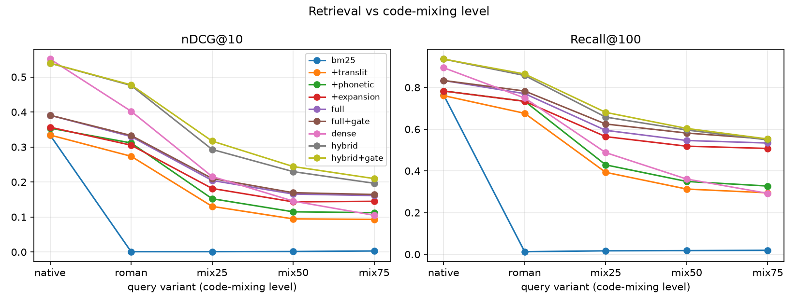
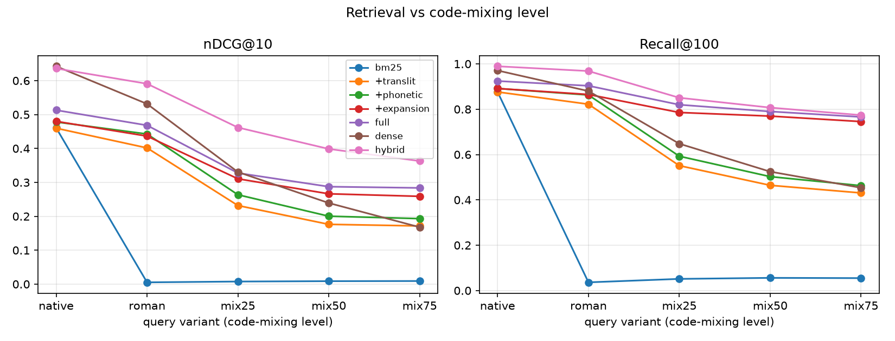

# hinglish-ir: retrieving Hindi passages with romanised and code-mixed queries

How much does retrieval over Hindi Wikipedia (MIRACL-hi, Devanagari passages) degrade when
the *query* is typed in romanised Hindi or in Hindi-English code-mix instead of Devanagari,
and how much of the loss can an IR pipeline recover?

The core IR parts (inverted index, BM25, phonetic keys, query normalisation, fusion, metrics,
significance test) are written from scratch. Libraries are used for data download,
transliteration (IndicXlit), embeddings (multilingual-e5-small), LLM calls and plots.

## Setup

```bash
make setup            # .venv (Python 3.12) + .venv-xlit (Python 3.10, IndicXlit)
cp .env.example .env  # add GROQ_API_KEY (only needed if the LLM caches are missing)
make data             # download MIRACL-hi + build the sample corpus   (MODE=--full for 506k)
make index            # inverted index (sample: ~10 s, full: ~70 s)
make index-lucene     # optional: Lucene-style index, adds a row to the sanity check
make variants         # query variants (cached in data/variants.jsonl -> no API calls)
make eval             # all experiments -> results/
make search           # CLI demo
make demo             # Streamlit app
make test
```

`--sample` (default) = every passage judged for train+dev queries + 50,000 random passages
(63,452 passages). `--full` = all 506,264 passages. `uv` is used for environments.
The ZIP ships the sample only; `python scripts/download_data.py` re-downloads everything.

All LLM output is cached (`data/cache/llm.jsonl`, `data/cache/lexicon.json`,
`data/cache/xlit.json`, `data/variants.jsonl`), so `make eval` reproduces the numbers offline.

## Data and query variants

MIRACL-hi: 1,169 train / 350 dev queries with qrels; dev is the test set (test qrels are
hidden). Tuning uses a fixed random subset of 400 train queries (seed 42), because each
query needs four LLM-generated variants and the free API tier is rate-limited
(see `docs/adr/0003`).

| variant | how it is made |
|---|---|
| native | original Devanagari query |
| roman | casual romanised Hindi as typed on a phone (LLM, `openai/gpt-oss-120b`, T=0) |
| mix25 / mix50 / mix75 | romanised, with ~25/50/75 % of content words replaced by English (LLM) |
| roman_rule | deterministic romanisation (indic_transliteration Harvard-Kyoto, lower-cased, final schwa dropped) |

Examples: `results/variant_examples.md`.

## Pipeline

```
query ─ tokenise (NFC, ZW removal, digits) ─ per-token script detection
        ├─ Devanagari token ──────────────────────────────────────────┐
        └─ Latin token ─ romanised stop word? drop                     │
                       ─ IndicXlit → Devanagari (+ keep Latin form)    │
                       ─ LLM lexicon: English? → add Hindi equivalent  │
                                                                       ▼
        query terms ── field "tok"/"stem" (BM25) + field "phon" (phonetic keys, BM25)
                                         │
             dense e5-small ─────────────┤  weighted RRF (k, w tuned on train)
                                         ▼
                                      ranking
```

* `src/text.py` – NFC normalisation, Devanagari-aware tokeniser (keeps matras), stop words,
  light suffix stemmer (Ramanathan & Rao style). Each step toggleable.
* `src/index.py`, `src/bm25.py` – CSR inverted index with three fields (`tok`, `stem`,
  `phon`), BM25 (k1 = 1.2, b = 0.75) with per-term score breakdown.
* `src/phonetic.py` – Soundex-style key on the Devanagari form: merges vowel length,
  e/ai, o/au, nasalisation (incl. half-nasal consonants), aspiration, nukta,
  retroflex/dental t/d/n and the sibilants; collapses repeats. Indexed as a second field.
* `src/normalise.py` – script detection, IndicXlit transliteration (LLM fallback),
  bilingual expansion via a cached per-token LLM lexicon.
* `src/dense.py` – multilingual-e5-small. With a GPU the whole corpus is embedded once;
  on CPU only the BM25 top-100 per query are embedded and reranked.
* `src/fusion.py` – weighted reciprocal rank fusion.
* `src/eval.py` – all experiments.

## Results

All numbers are on the 350 MIRACL-hi **dev** queries. Weights were tuned on train only
(`results/tuned.json`). Files in `results/` carry a `_sample` or `_full` suffix.

| file | content |
|---|---|
| `sanity_*.txt`, `sanity_*.csv` | native BM25 (our analyser, paper k1/b, Lucene analyser port) vs the MIRACL paper |
| `main_nDCG10_*.csv`, `main_Recall100_*.csv`, `main_P10_*.csv`, `main_F110_*.csv`, `main_MRR10_*.csv` | systems × variants |
| `main_long_*.csv` | every metric, long format |
| `degradation_*.png`, `baseline_degradation_*.png` | metric vs code-mixing level |
| `ablation_nDCG10_*.csv`, `ablation_long_*.csv` | full pipeline minus one component |
| `significance_*.csv` | paired randomisation test (10k permutations): full vs BM25, hybrid vs BM25 / dense / full |
| `failures_*.md` | 15 queries the pipeline still fails, with the normalised query |
| `tuning_*.csv`, `tuned.json` | train-set tuning log and chosen weights |
| `variant_examples.md` | example variants per level |
| `mix_ratio.csv` | measured code-mixing level per variant (target vs actual) |

### Key findings

1. **Romanised queries break lexical retrieval.** On the full corpus, native BM25 reaches
   nDCG@10 0.334, while roman queries get 0.001 and code-mixed ones at most 0.003. Latin
   tokens match almost nothing in Devanagari passages.
2. **Normalisation recovers most of the roman loss.** Transliteration alone brings roman
   queries to 0.274. With phonetic keys, expansion and stemming the full pipeline reaches
   0.330, about the same as native BM25 (0.334).
3. **Code-mixing is the harder problem.** Full BM25 falls from 0.330 (roman) to 0.161
   (mix75). Bilingual expansion is the component that helps here: Recall@100 at mix75
   rises from 0.33 (+phonetic) to 0.51 (+expansion).
4. **Dense and lexical retrieval fail differently.** e5-small is the strongest single
   system on native queries (0.551) but degrades fastest with English mixing
   (0.105 at mix75, below full BM25's 0.161).
5. **The hybrid is best on every non-native variant on both corpora** (full corpus:
   0.476 roman, 0.293 mix25, 0.196 mix75). On native queries dense-only is slightly
   ahead (0.551 vs 0.539). The fusion weight tuned on train (w_dense = 0.75) gives up a
   little native accuracy for robustness to code-mixing. The hybrid beats BM25 and the
   full pipeline on every variant (p < 0.001), and beats dense-only on every non-native
   variant (full corpus: +0.07 to +0.09 nDCG@10, p ≤ 0.001). On native queries the
   difference to dense-only (−0.012) is not significant (p = 0.49).
6. **Not every component helps everywhere (ablation).** Transliteration is essential: without
   it, roman drops from 0.330 to 0.029. Stemming and phonetic keys help on every variant.
   But expansion *hurts* pure-roman queries on the full corpus (removing it gives roman
   0.337 and roman_rule 0.299, against 0.330 and 0.274). The context-free lexicon sometimes
   tags romanised Hindi as English and adds wrong Hindi words. Query-side stop-word removal
   also hurts slightly on most variants. A per-query decision on whether to expand is the
   obvious next step.
7. **Sanity check: our BM25 reproduces the MIRACL baseline.** Native BM25 on the full corpus
   (k1 = 1.2, b = 0.75, no stemming) gives nDCG@10 0.334 against 0.458 in the MIRACL paper.
   The paper's k1 = 0.9, b = 0.4 alone gives 0.381, and adding our stemmer gives 0.420. With a
   port of Lucene's Hindi analyser (`src/lucene_hindi.py`: Indic + Hindi normaliser, Lucene's
   stop words removed from documents too, Lucene's Hindi stemmer) the same BM25 code gives
   **0.455 nDCG@10 / 0.867 Recall@100 vs the paper's 0.458 / 0.868**. The gap was the text
   analysis, not the retrieval model. All setups are in `results/sanity_full.csv`.

The tables below are generated from the CSVs by `scripts/render_results.py`.

<!-- results:start -->
### Full corpus (506,264 passages)

Sanity check:

```
mode=full: native-script BM25 on MIRACL-hi dev (350 queries)
  k1=1.2 b=0.75, no stemming (our default)   nDCG@10=0.334 Recall@100=0.764
  k1=1.2 b=0.75, stemming                    nDCG@10=0.372 Recall@100=0.788
  k1=0.9 b=0.4, no stemming (paper k1/b)     nDCG@10=0.381 Recall@100=0.789
  k1=0.9 b=0.4, stemming (paper k1/b)        nDCG@10=0.420 Recall@100=0.821
  k1=0.9 b=0.4, Lucene Hindi analyser (port) nDCG@10=0.455 Recall@100=0.867
  MIRACL paper (Zhang et al. 2023), BM25 hi dev  nDCG@10=0.458 Recall@100=0.868 (Anserini, Lucene Hindi analyser, k1=0.9 b=0.4)
```

**nDCG@10** (best per column in bold)

| system | native | roman | mix25 | mix50 | mix75 | roman_rule |
|---|---|---|---|---|---|---|
| bm25 | 0.334 | 0.001 | 0.001 | 0.001 | 0.003 | 0.000 |
| +translit | 0.334 | 0.274 | 0.130 | 0.095 | 0.093 | 0.229 |
| +phonetic | 0.354 | 0.312 | 0.152 | 0.115 | 0.112 | 0.280 |
| +expansion | 0.356 | 0.305 | 0.182 | 0.143 | 0.145 | 0.254 |
| full | 0.391 | 0.330 | 0.204 | 0.166 | 0.161 | 0.274 |
| dense | **0.551** | 0.402 | 0.216 | 0.145 | 0.105 | 0.309 |
| hybrid | 0.539 | **0.476** | **0.293** | **0.230** | **0.196** | **0.393** |

**Recall@100** (best per column in bold)

| system | native | roman | mix25 | mix50 | mix75 | roman_rule |
|---|---|---|---|---|---|---|
| bm25 | 0.764 | 0.013 | 0.017 | 0.018 | 0.019 | 0.005 |
| +translit | 0.761 | 0.676 | 0.393 | 0.313 | 0.295 | 0.592 |
| +phonetic | 0.783 | 0.734 | 0.429 | 0.349 | 0.327 | 0.677 |
| +expansion | 0.783 | 0.734 | 0.564 | 0.518 | 0.508 | 0.662 |
| full | 0.834 | 0.770 | 0.595 | 0.546 | 0.534 | 0.703 |
| dense | 0.895 | 0.750 | 0.488 | 0.361 | 0.292 | 0.656 |
| hybrid | **0.936** | **0.857** | **0.658** | **0.596** | **0.549** | **0.814** |



**Ablation, nDCG@10** (full pipeline minus one component)

| ablation | native | roman | mix25 | mix50 | mix75 | roman_rule |
|---|---|---|---|---|---|---|
| full | 0.391 | 0.330 | 0.204 | 0.166 | **0.161** | 0.274 |
| full - expansion | 0.388 | **0.337** | 0.164 | 0.120 | 0.116 | **0.299** |
| full - phonetic | 0.375 | 0.287 | 0.183 | 0.151 | 0.155 | 0.216 |
| full - stemming | 0.356 | 0.305 | 0.182 | 0.143 | 0.145 | 0.254 |
| full - stopwords | **0.403** | 0.337 | **0.215** | **0.169** | 0.152 | 0.273 |
| full - translit | 0.391 | 0.029 | 0.062 | 0.078 | 0.082 | 0.006 |

**Paired randomisation test, nDCG@10 delta** (10,000 permutations; p=0.0001 is the smallest reportable value)

| system vs baseline | native | roman | mix25 | mix50 | mix75 | roman_rule |
|---|---|---|---|---|---|---|
| full vs bm25 | +0.057 (p=0.0001) | +0.329 (p=0.0001) | +0.203 (p=0.0001) | +0.164 (p=0.0001) | +0.158 (p=0.0001) | +0.274 (p=0.0001) |
| hybrid vs bm25 | +0.206 (p=0.0001) | +0.475 (p=0.0001) | +0.292 (p=0.0001) | +0.228 (p=0.0001) | +0.193 (p=0.0001) | +0.393 (p=0.0001) |
| hybrid vs dense | -0.012 (p=0.4868) | +0.074 (p=0.0006) | +0.077 (p=0.0001) | +0.084 (p=0.0001) | +0.091 (p=0.0001) | +0.084 (p=0.0001) |
| hybrid vs full | +0.149 (p=0.0001) | +0.146 (p=0.0001) | +0.089 (p=0.0001) | +0.064 (p=0.0001) | +0.035 (p=0.0001) | +0.119 (p=0.0001) |

Other metrics (P@5, P@10, F1@10, MRR@10, R@10): `results/main_long_full.csv`. Failure analysis: `results/failures_full.md`.

### Sample corpus (63,452 passages)

Sanity check:

```
mode=sample: native-script BM25 on MIRACL-hi dev (350 queries)
  k1=1.2 b=0.75, no stemming (our default)   nDCG@10=0.461 Recall@100=0.876
  k1=1.2 b=0.75, stemming                    nDCG@10=0.495 Recall@100=0.913
  k1=0.9 b=0.4, no stemming (paper k1/b)     nDCG@10=0.482 Recall@100=0.888
  k1=0.9 b=0.4, stemming (paper k1/b)        nDCG@10=0.522 Recall@100=0.919
  k1=0.9 b=0.4, Lucene Hindi analyser (port) nDCG@10=0.549 Recall@100=0.952
  MIRACL paper (Zhang et al. 2023), BM25 hi dev  nDCG@10=0.458 Recall@100=0.868 (Anserini, Lucene Hindi analyser, k1=0.9 b=0.4)
```

**nDCG@10** (best per column in bold)

| system | native | roman | mix25 | mix50 | mix75 | roman_rule |
|---|---|---|---|---|---|---|
| bm25 | 0.461 | 0.005 | 0.008 | 0.009 | 0.009 | 0.003 |
| +translit | 0.460 | 0.402 | 0.232 | 0.176 | 0.172 | 0.346 |
| +phonetic | 0.478 | 0.443 | 0.264 | 0.200 | 0.193 | 0.406 |
| +expansion | 0.480 | 0.436 | 0.311 | 0.266 | 0.259 | 0.398 |
| full | 0.513 | 0.468 | 0.328 | 0.287 | 0.284 | 0.433 |
| dense | **0.642** | 0.531 | 0.331 | 0.239 | 0.168 | 0.449 |
| hybrid | 0.636 | **0.591** | **0.462** | **0.399** | **0.363** | **0.534** |

**Recall@100** (best per column in bold)

| system | native | roman | mix25 | mix50 | mix75 | roman_rule |
|---|---|---|---|---|---|---|
| bm25 | 0.876 | 0.036 | 0.051 | 0.056 | 0.055 | 0.011 |
| +translit | 0.876 | 0.822 | 0.551 | 0.464 | 0.431 | 0.755 |
| +phonetic | 0.891 | 0.863 | 0.593 | 0.503 | 0.463 | 0.835 |
| +expansion | 0.891 | 0.865 | 0.785 | 0.770 | 0.746 | 0.828 |
| full | 0.924 | 0.903 | 0.820 | 0.790 | 0.766 | 0.856 |
| dense | 0.971 | 0.880 | 0.648 | 0.525 | 0.454 | 0.814 |
| hybrid | **0.989** | **0.968** | **0.851** | **0.807** | **0.774** | **0.946** |



**Ablation, nDCG@10** (full pipeline minus one component)

| ablation | native | roman | mix25 | mix50 | mix75 | roman_rule |
|---|---|---|---|---|---|---|
| full | 0.513 | 0.468 | 0.328 | 0.287 | **0.284** | 0.433 |
| full - expansion | 0.510 | 0.466 | 0.270 | 0.210 | 0.201 | 0.433 |
| full - phonetic | 0.497 | 0.431 | 0.309 | 0.275 | 0.271 | 0.361 |
| full - stemming | 0.480 | 0.436 | 0.311 | 0.266 | 0.259 | 0.398 |
| full - stopwords | **0.518** | **0.476** | **0.343** | **0.293** | 0.273 | **0.439** |
| full - translit | 0.513 | 0.070 | 0.141 | 0.174 | 0.180 | 0.014 |

**Paired randomisation test, nDCG@10 delta** (10,000 permutations; p=0.0001 is the smallest reportable value)

| system vs baseline | native | roman | mix25 | mix50 | mix75 | roman_rule |
|---|---|---|---|---|---|---|
| full vs bm25 | +0.052 (p=0.0001) | +0.463 (p=0.0001) | +0.320 (p=0.0001) | +0.279 (p=0.0001) | +0.275 (p=0.0001) | +0.430 (p=0.0001) |
| hybrid vs bm25 | +0.175 (p=0.0001) | +0.586 (p=0.0001) | +0.454 (p=0.0001) | +0.390 (p=0.0001) | +0.354 (p=0.0001) | +0.532 (p=0.0001) |
| hybrid vs dense | -0.006 (p=0.6666) | +0.059 (p=0.0011) | +0.131 (p=0.0001) | +0.160 (p=0.0001) | +0.195 (p=0.0001) | +0.086 (p=0.0001) |
| hybrid vs full | +0.123 (p=0.0001) | +0.123 (p=0.0001) | +0.134 (p=0.0001) | +0.111 (p=0.0001) | +0.079 (p=0.0001) | +0.101 (p=0.0001) |

Other metrics (P@5, P@10, F1@10, MRR@10, R@10): `results/main_long_sample.csv`. Failure analysis: `results/failures_sample.md`.
<!-- results:end -->

## Demo

```bash
python -m src.cli search "roth ira pe tax kitna lagta hai" --system full --explain
streamlit run app.py      # HIR_MODE=full streamlit run app.py for the full corpus
```

The CLI prints the detected script per token, the transliteration / expansion of each
Latin token, the normalised query, the top passages and each term's BM25 contribution.
The app shows BM25 and a chosen system side by side, with the per-token analysis.
If the LLM is unreachable for a new word, the demo still answers, without expansion,
and shows a warning.

## Tests

`make test`: BM25 against the formula on a toy corpus, score breakdown, phonetic key
merges/separations, script detection and tokenisation, metrics, RRF, normalisation.

## Design decisions

`docs/adr/`: LLM provider/models (0001), IndicXlit in a separate Python 3.10 venv (0002),
evaluation protocol (0003).

## Limitations and threats to validity

* **Synthetic queries.** Roman and code-mixed variants are LLM-generated, not real user
  queries. To reduce circularity, variants come from `gpt-oss-120b`, transliteration from
  IndicXlit (a separate seq2seq model) and the lexicon from `gpt-oss-20b`. `roman_rule`
  is a deterministic check that involves no LLM.
* **Mixing levels are compressed.** The LLM was asked for ~25/50/75 % English content
  words. Measured on dev (`python -m src.mixcheck` → `results/mix_ratio.csv`, exact token
  diff against the roman variant), mix25/50/75 replace on average 43/61/70 % of content
  words (medians 38/60/71 %). mix25 overshoots and mix75 undershoots, which is part of why
  mix50 and mix75 score so close together. Read the levels as an ordering, not as exact
  percentages.
* **Context-free lexicon.** Each Latin token is looked up on its own, so ambiguous tokens
  (`me`, `ira`) can be mis-expanded. Example: "ira" → आईआरए (the Irish Republican Army).
* **Sample corpus is easier** than the full corpus (fewer distractors), so sample numbers
  are higher. Compare systems within one corpus, and use the full-corpus sanity check
  against the MIRACL paper.
* **Tuning on 400 train queries**, not all 1,169 (API rate limits, ADR 0003).
* **BM25 settings.** k1 = 1.2, b = 0.75 and our own analyser, as specified. The MIRACL
  paper's Anserini setup (k1 = 0.9, b = 0.4, Lucene Hindi analyser) scores higher on native
  queries; our port of it reproduces the paper's number (sanity check), but the experiments
  keep the specified settings. The port uses our tokenizer, not Lucene's StandardTokenizer.

## AI use

* **Code.** The project was built with Claude Code (Claude Opus 5.5) as a pair programmer,
  following a written specification (components, experiments, order of work). Every stage
  was run and checked against its output before moving on: unit tests, the BM25 sanity
  check against the MIRACL paper, and inspection of variants and transliterations.
  Bugs found that way (rule-based romaniser dropping long vowels, an IndicXlit batch-API
  shape mismatch, a stop word swallowing the expansion "कर" = tax) were fixed and are
  covered by the tests or the git history.
* **Inside the pipeline.** LLMs are used only for judgments that exact code cannot make,
  and every call is commented with the judgment it makes:
  - generating the romanised / code-mixed query variants (`src/variants.py`, `gpt-oss-120b`)
  - deciding whether a Latin token is English and giving its Hindi equivalent
    (`src/normalise.py`, `gpt-oss-20b`)

  Indexing, BM25, phonetic keys, fusion, metrics and the significance test are plain code.
* **Reproducibility.** Every LLM response is cached and shipped (temperature 0), so the
  reported numbers reproduce without an API key.
